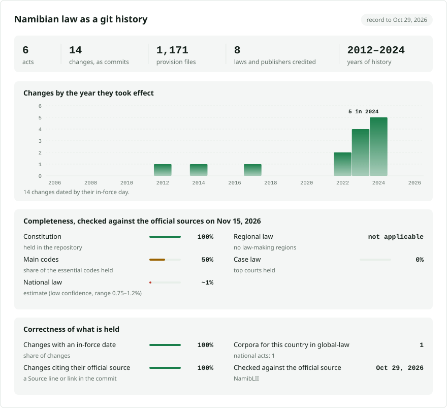

# Namibia: law history in git

<picture>
<source media="(prefers-color-scheme: dark)" srcset="data/effort-dark.svg">

</picture>

The law of Namibia as a git history: one file per section (or article or schedule), one commit per change on the day it took effect, and the law that made each change as the commit's author. `git blame` names the law behind every paragraph; `git log` lists every change to a section; picking a date gives the text in force that day.

Part of [lexifina/global-law](https://github.com/lexifina/global-law), one git history for every country's law: this is Namibia's national law, which global-law reads at `namibia/national/acts/`.

**What is in it now:** 6 acts from NamibLII, with 12 versions from 2012 to 2024: the Namibian Constitution (1 version), the Labour Act, 2007 (2), the Companies Act, 2004 (3), the Income Tax Act, 1981 (2), the Customs and Excise Act, 1998 (2) and the Value-Added Tax Act, 2000 (2). [`REPRODUCE.md`](REPRODUCE.md) lists every act with its versions; [`data/versions.json`](data/versions.json) lists every version with its source.

Each act is a folder, one file per provision, plus a `README.md` listing its provisions and their changes (`labour/sec-011.md` is section 11 of the Labour Act, 2007, Act 11 of 2007: payment of remuneration).

The text is in English, the language Namibia's laws are published in, as NamibLII prints it.

## Questions as git commands

| Question | Command |
| --- | --- |
| Every change to section 11 of the Labour Act | `git log -p --word-diff -- labour/sec-011.md` |
| Which law wrote each line of section 11? | `git blame labour/sec-011.md` |
| Every version of the Labour Act, with the day each took effect | `git log --format="%h %(trailers:key=In-force,valueonly,separator=) %an" -- labour ':!*/README.md'` |
| Section 11 as in force on 1 January 2020 | `python tools/on.py 2020-01-01 labour sec-011` |

**Outside git**, we also host this record publicly, for free:

- **[Ask Claude about Namibian law](https://global-law.lexifina.com/v1/try_claude?country=namibia)**: opens Claude with a first question ready.
- **[Ask ChatGPT](https://global-law.lexifina.com/v1/try_chatgpt?country=namibia)**: the same question in ChatGPT.
- **[Search Namibian law on our site](https://lexifina.com/law?country=namibia&q=annual+leave)**: a search for "annual leave", with each provision's text and its versions, no account needed.
- **[Developer REST API](https://global-law.lexifina.com/v1/search_law?query=annual+leave&jurisdiction=namibia)**: the same search as JSON, with no key. See the [documentation here](https://lexifina.com/api/global-law).

Both assistants read the record through the free Global law connector (MCP, `https://global-law.lexifina.com/mcp`); the first time, the chat gives you the link that adds it. Ask in English.

**Host it yourself easily.** All it takes is git and Python, and the tools run on your machine:

```sh
git clone --depth 1 https://github.com/lexifina/global-law && cd global-law
python3 tools/countries.py add namibia/national/acts
python3 tools/law.py show 2026-01-01 namibia/national/acts/labour/sec-011.md
```

Opened in Claude Code, Cursor, VS Code or Codex, the clone also starts a local MCP server with the same tools ([MCP.md](https://github.com/lexifina/global-law/blob/main/MCP.md)).

## Dates

Each commit is dated at noon, Africa/Windhoek, on the day the version took effect, and carries it in its `In-force:` trailer:

- for a version that takes in an amendment, the date of NamibLII's point-in-time version: the day the amending law came into force, as Laws.Africa records it (Act 16 of 2022, the Abolition of Payment by Cheque Act: 15 March 2023);
- for the oldest version of each act, the date of the oldest NamibLII version kept, which already holds the earlier amendments (the Labour Act: 1 August 2012, as amended by Act 2 of 2012);
- where NamibLII lists earlier versions the Internet Archive holds no copy of, the history starts after the last of them, so no change is dated late: the Income Tax and VAT Acts from 15 March 2023, the Customs and Excise Act from 23 February 2022.

Each change is credited to the law that made it, as NamibLII names it (`Act 16 of 2022 <act-2022-16@namiblii.invalid>`, or a Government Notice, `Gn 215 of 2022`). The oldest version of each act is credited to the publisher, `NamibLII`, and its commit message lists the laws it already holds. Where one version takes in several laws, a provision is credited to a law only if NamibLII's editorial note in it names that law; the rest are the publisher's, labelled "unexplained".

## How it is checked

- `tools/check_repo.py` reads every version back from git on the day it took effect and on the day before, and compares it with the corpus: 12 versions of 6 acts, 0 mismatches, and no commit whose trailers git cannot parse (see [`REPRODUCE.md`](REPRODUCE.md)).
- Every version is read from an archived copy of exactly that dated NamibLII page, whose sha256 is recorded with it; every text of a version, except the headings and notes left out, is checked to be in a provision file.
- A second build from the same corpus gave the same hashes for all 14 history commits and 19 tags.
- History is append-only: no merge commits, no commit dates that go backwards, and none after the build.
- [vulnerabilities/](vulnerabilities/): possible drafting mistakes in this law, found by global-law's detectors and checked by hand. Not run yet.

## What it does not show

- **Most Namibian law.** Only these 6 acts are here; there is no subordinate legislation, case law or bill. The Criminal Procedure Act, 1977 was tried and left out, because every archived copy of one of its versions is cut off or empty.
- **The Constitution before 2014.** NamibLII's one version takes in all three amendment Acts (1998, 2010, 2014); the 1990 text and those Acts exist only as scanned Gazette PDFs, and no OCR is used.
- **Earlier history.** Changes before an act's oldest version are folded into it, and amendments NamibLII has not applied to its text are not here.
- **Editorial matter.** NamibLII's bracketed notes are read for credits only (kept where a provision has no other text), and Part, Chapter and Division headings are left out.
- **Changes within a line.** Each paragraph is one line, so blame credits a whole paragraph to the law that changed one word of it.

## Sources

| Source | Kind | Past versions | Notes |
| --- | --- | --- | --- |
| [NamibLII](https://namiblii.org) (Law Reform and Development Commission, Ministry of Justice; Laws.Africa) | Consolidated legislation | yes, dated point-in-time versions | The text and date of every version, its amendment history, and the editorial notes used for credits; not the Government Gazette text |
| [Internet Archive](https://web.archive.org/) | Archived copies of NamibLII's pages | as captured | Each version is read from the copy of its own dated page |

## Licence

See [`LICENSE`](LICENSE). NamibLII licenses its content under CC BY-NC 4.0, crediting NamibLII as the source (its terms of use, section 9), so the texts may be used only for non-commercial purposes. Lexifina's own contributions (the arrangement of the history, the commit messages, the tables and the tools) are CC0 1.0.

No AI model wrote, translated or corrected legal text, and none runs when the history is built; the scripts were written by an AI model (see [`REPRODUCE.md`](REPRODUCE.md)).

## Visualisations

- [visualisations/](visualisations/): charts drawn from this repository. Not drawn yet.

## More

From [lexifina/global-law](https://github.com/lexifina/global-law):

- [FEATURES.md](https://github.com/lexifina/global-law/blob/main/FEATURES.md): every feature, and what every corpus must support (`git blame`, `law.py`, the MCP tools)
- [FAQ.md](https://github.com/lexifina/global-law/blob/main/FAQ.md): questions and answers · [CONTRIBUTING.md](https://github.com/lexifina/global-law/blob/main/CONTRIBUTING.md): proposing changes · [MCP.md](https://github.com/lexifina/global-law/blob/main/MCP.md): the MCP server · [REPRODUCE.md](https://github.com/lexifina/global-law/blob/main/REPRODUCE.md): how it was built · [CHANGELOG.md](https://github.com/lexifina/global-law/blob/main/CHANGELOG.md)
- [FRESHNESS.md](https://github.com/lexifina/global-law/blob/main/FRESHNESS.md): how current each corpus is · [Monitoring](https://github.com/lexifina/global-law/tree/main/monitoring): whether updates are running · [WATCHING.md](https://github.com/lexifina/global-law/blob/main/WATCHING.md): how each official source is watched for changes
- [performance/](https://github.com/lexifina/global-law/tree/main/performance): how fast the tools are, measured
- [visualisations/](https://github.com/lexifina/global-law/tree/main/visualisations): charts and bridges across the world's law
- [Vulnerabilities](https://github.com/lexifina/global-law/tree/main/vulnerabilities): mistakes in legislation as published
